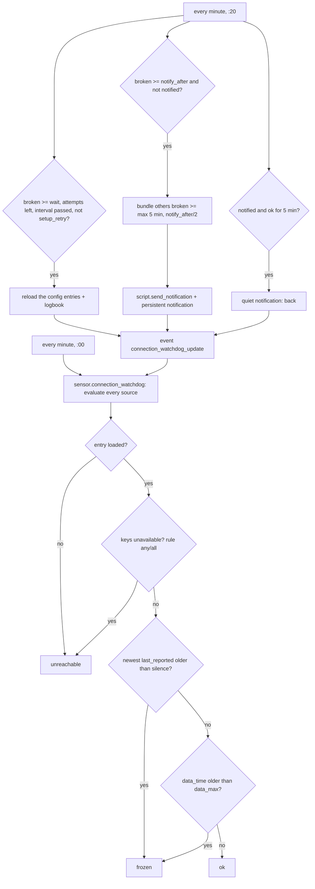

# Logic: <@ module.name @>

Every decision of the module, so you can check and change it. Files: `custom_templates/connection_watchdog.jinja` (status per source), `templates/connection_watchdog.yaml` (sensors), `automations.yaml` (reload, notify, report back), `www/connection-watchdog-card.js` (card).

## In one sentence

Every minute one sensor judges every source (unreachable, frozen, stale data), and one automation 20 seconds later reloads what has been broken long enough, sends one bundled notification per outage and a quiet one when it is back, and tells the sensor what it did.

## Flow chart

## Triggers

| What | Trigger | Why |
| ---- | ------- | --- |
| Sensor | every minute on :00, Home Assistant start, template reload | one render per minute instead of state tracking on dozens of entities; the cost is about 50 ms per minute at the source on a Home Assistant Yellow |
| Sensor | event `connection_watchdog_update` | the automation reports reloads, notifications and recoveries; the sensor keeps them in its attributes |
| Sensor | `input_select.connection_watchdog_test` | the test source appears and disappears at once |
| Automation | every minute on :20 | 20 s after the sensor, so it always reads a fresh judgement; `mode: single`, an overlapping run is dropped silently |

## Conditions and decisions

### Status of a source (in this order)

1. **Unreachable**, when one of its config entries is not `loaded` (`setup_retry`, `setup_error`, `not_loaded`, a removed entry), or when its keys are unavailable or unknown: one key with `rule: any` (default), every key with `rule: all`.
2. **Frozen**, when the newest `last_reported` of the available keys is older than `silence`. `last_reported` also moves when an integration writes an unchanged value, so a sensor that stays at 20 °C is not frozen; an integration that stops polling is. The newest of all keys counts, so one key that stands still on purpose (a meter at exactly 0 W) does not trigger it.
3. **Frozen (data)**, when the state of `data_time` (the time inside the data) is older than `data_max`. For a cloud API that keeps writing old figures every minute: `last_reported` keeps moving there.
4. **Ok** otherwise.

`since` runs on while the source stays ok or stays broken: a switch between unreachable and frozen is the same outage.

### Which config entries

The config entries of a source are the ones that own its keys (looked up every minute), plus `entries` from `house.yaml`. When the keys are gone from the entity registry while the source is broken (an integration that came back without its entities: at the source a climate unit that dropped off the wifi), the entries remembered from the previous minute are used, so the reload still happens.

### Generic catch

Every other config entry that owns at least one `unavailable` entity and is not `loaded` (and not `not_loaded`, and not disabled) becomes an extra source `entry_<id>`: name "title (domain)", 2 reloads, impact "unknown". So an integration you forgot or added later is not outside the watch. `ignore` (domain or entry id) leaves an entry out on purpose.

### Reload

A source is reloaded when all of these hold:

- it has been broken for at least `wait` minutes;
- it has config entries and none of them is in `setup_retry` (Home Assistant retries those itself, about every 80 s; a reload would only reset its timer). As soon as the entry is `loaded` again but the entities stay away, it does reload;
- fewer than `max` attempts in this outage;
- at least `interval` minutes since the last attempt.

`homeassistant.reload_config_entry` for every entry of the source, `continue_on_error` so one failing entry does not stop the others, and a logbook line on `sensor.connection_watchdog` ("reloads X (attempt n/max)").

### Notify

- **One notification per outage**: a source is notified once it has been broken for `notify_after` minutes; `notified` stays true until it is back.
- **Bundle**: when one source is due, every other broken source that is not notified yet and has been broken for at least max(5 min, `notify_after` / 2) joins the same notification. An internet outage gives one notification, not ten. The rest that is still down is named in one line "Still down: …".
- **Content**: per source what is broken and since when, the reason, the impact, how many reloads failed (or "keeps retrying by itself" while Home Assistant retries), and the action.
- **Back**: a notified source that has been ok for 5 minutes gives one quiet notification (`interruption-level: passive` on iOS). When a new problem and a recovery fall in the same run, they share the notification.
- **Tag** `connection_watchdog`: a new notification replaces the previous one on the phone. A tap opens `tap_url`.
- **Safety net**: on every notification run a persistent notification in Home Assistant with the current list (for when the push itself does not arrive, or the phone's notify service is the broken source); dismissed on the run where nothing is down any more.

### Report back

The sensor cannot see what the automation did, and the automation cannot write attributes. So the automation fires at most one event per run, `connection_watchdog_update` with `updates: [{source, kind}]` (`attempt`, `notified`, `recovered`); the sensor renders on that event and counts attempts and notifications in its attributes. Trigger-based template sensors restore their attributes after a restart, so the memory survives one.

## Settings

| What | Where | Default |
| ---- | ----- | ------- |
| Sources and thresholds | `house.yaml` `connection_watchdog.sources` | `wait` 5, `notify_after` 15, `max` 6, `interval` 10, no `silence`, no `data_time` |
| Generic catch | in the macro | `wait` 5, `notify_after` 15, `max` 2, `interval` 10 |
| Test source | in the macro | `wait` 1, `notify_after` 3, `max` 2, `interval` 1, data older than 2 min = frozen |
| Recovery delay | `automations.yaml` | 5 min ok before "back" |
| Bundle threshold | `automations.yaml` | max(5 min, `notify_after` / 2) |
| On/off | `automation.connection_watchdog_repair_and_notify` | on |
| Test | `input_select.connection_watchdog_test` | `off` (module.yaml `defaults:`) |

## Edge cases

1. **Home Assistant restarts**: every integration is briefly not loaded. `wait` (5 min) and `notify_after` (15 min) let them come up first; a source that is still broken after that is a real problem.
2. **The whole internet is down**: every cloud source breaks at once; one notification (the bundle), and the push may not arrive at all: the persistent notification is the record.
3. **An integration in `setup_retry` for hours**: no reloads are counted (Home Assistant retries itself); the notification says so.
4. **Keys renamed or removed**: the source stays `unreachable` ("1 of 1 not available") until `house.yaml` is fixed; `deploy.py` names the missing keys.
5. **An entity that is unavailable on purpose** (a device switched off for the season): leave it out of `keys`, or put the integration in `ignore` for the generic catch.
6. **A source whose keys are gone from the registry before the watchdog ever saw it broken**: no entries to remember, so no reload; the notification still comes.
7. **More than one phone**: the recipients come from the module `notifications`; one offline phone does not block the others.
8. **The notification service itself is the broken source**: the push may not arrive; the persistent notification still does.

## What it does not do

- Watch Home Assistant itself: when Home Assistant or its host is down, nothing here runs. Use an outside check for that (a ping from another machine, a cloud health check).
- Restart Home Assistant, power-cycle a device or touch the network: it only reloads config entries; the action text tells a person what to do.
- Judge devices that are not part of a source: a single camera that is off is a device, not an integration.
- Keep a history beyond the logbook lines and the notifications.

## Test plan

On a real Home Assistant, after `deploy.py --view`.

| # | Test | How | Expected |
| - | ---- | --- | -------- |
| 1 | First render | wait one minute after the deploy | `sensor.connection_watchdog` has a number; every source in the card; a missing key shows up as `unreachable` |
| 2 | Unreachable | set the test source to `unreachable` | after 1 and 2 min a simulated reload in the logbook ("test source: reload simulated"), after 3 min one notification and the persistent notification; the card shows "Reloaded 2 of 2" and "Notification sent" |
| 3 | Back | set the test source to `ok` | after 5 min one quiet notification "Back: Test source"; the persistent notification is gone |
| 4 | Frozen | set the test source to `frozen` | after about 2 min status `frozen` ("data is n min old"), then the same course as test 2 |
| 5 | Off | set the test source to `off` | the test source leaves the list |
| 6 | Real reload | reload a watched integration by hand while it is fine, or unplug a local device for 10 min | `unreachable`, after `wait` min a real reload in the logbook; when it comes back: ok, and (if it was notified) a quiet notification |
| 7 | Bundle | unplug two local devices at the same time | one notification naming both |
| 8 | Chip | with `home-screen`: test 2 | the connections chip turns into a warning with the number; tap opens the view |

At the source (hand-made version, 2026-10-11): tests 1, 2, 3 and 6 passed (two real integrations reloaded and came back within a minute); test 4 on a real frozen source is still open.
