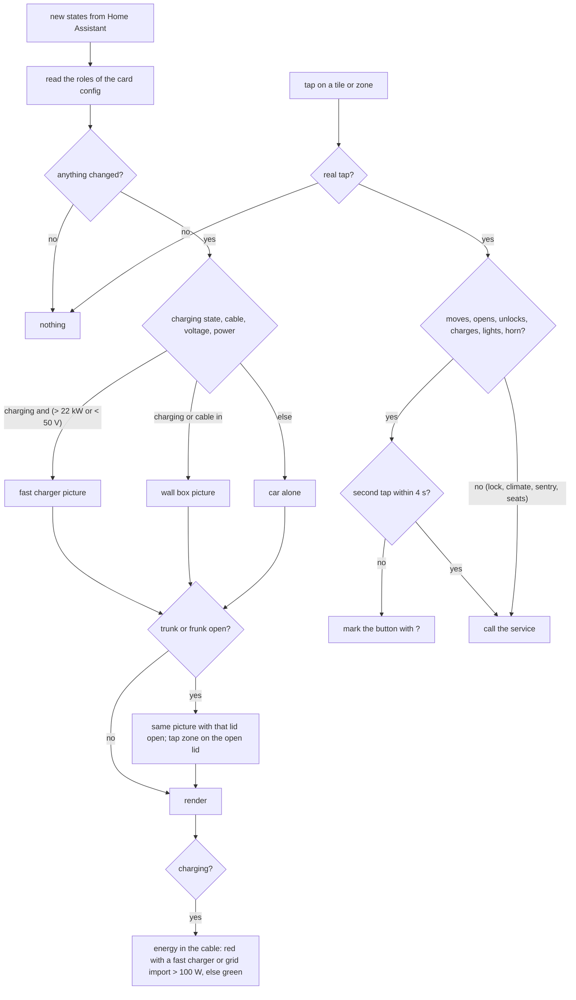
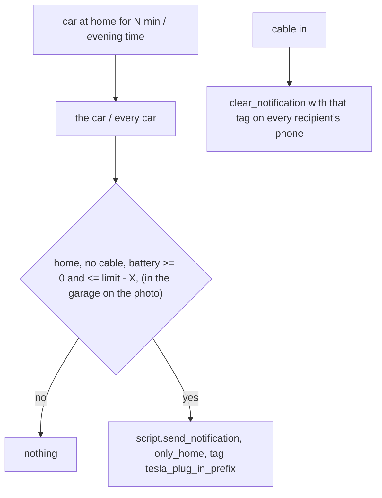

# <@ module.name @>: logic

<!-- Filled in by tools/fill.py (kept in a comment so a markdown formatter leaves it alone).
<% from '_tesla_car_card.jinja' import reminder, reminder_minutes, reminder_time, below_limit, garage_photo with context %>
<% set photo_clause = ', and the last garage photo names the car on one of the spots' if garage_photo else '' %>
-->

Status: in production at the source since 2026-10-12. The card runs daily in the author's house; the kit module itself is not deployed there yet. Every decision of the card (`www/tesla-car-card.js`) and of the optional plug-in reminder (`automations.yaml`) is below.

## In one sentence

The card shows one car the way the Tesla app does (picture, battery, charge state, controls) and only sends a command after a real tap, a second one for anything that moves or opens; the reminder tells whoever is home to plug in a car that stands at home without a cable while its battery is well below the charge limit.

## Flow chart

## Triggers

Card: every state update Home Assistant pushes to the dashboard (`set hass`). It renders again only when one of the values it shows changed (a signature of the read model), so an unrelated entity does not re-render it.

Reminder (only with `tesla_car_card.plug_in_reminder: true`, in this house: <@ 'on' if reminder else 'off' @>):

| Trigger                                 | id                 | What                                          |
| --------------------------------------- | ------------------ | --------------------------------------------- |
| `location` of a car to `home` for N min | `arrived_<prefix>` | check that car (N = `reminder_after_minutes`) |
| time `reminder_time`                    | `evening`          | check every car                               |
| `charge_cable` of a car to `on`         | `plugged_<prefix>` | clear that car's reminder on every phone      |

## Conditions and decisions

**Charge state.** `charging` = `charging_state` is `charging`. Fast charger = charging and (power above 22 kW or voltage below 50 V): a Supercharger reports about 0 kW and 1 V to the car, a wall box about 230 V. Mode: fast > charging at home > plugged in, not charging > not plugged in. Plugged in or charging (not fast) shows the wall box: a car plugged in away from home at a public AC charger also shows the wall box (accepted: the picture says "on a cable", not "at home").

**Picture.** With `model`: the charger picture first (fast or home), else the car alone. An open lid shows on top: trunk before frunk when both are open; with a charger the charger picture with that lid open, so charger and cable stay. With `image`: that picture as it is, no tap zones, no charger, no contact shadow.

**Energy in the cable.** Only while charging and only on a charger picture. Red when fast (a fast charger is grid power) or when `grid_power` imports more than 100 W (a sensor in kW is multiplied by 1000), else green. Speed on a log scale of the power (fast without power counts as 150 kW), between 0.45 s and 3.2 s per run; the animation keeps its phase with the clock so a new reading does not restart it. With "reduce motion" only the glow.

**Top right.** In the garage (location `home` and the garage photo names this prefix on one of `garage_spots`): only the garage icon. Otherwise the weather icon and temperature (outside temperature of the car, else the weather entity); at home with the driveway icon in front when a garage photo is configured (the photo said: not in the garage), or a home pin when none is.

**Tiles.** A tile appears only when its entity exists. Frunk and trunk: when open and the cover cannot close (feature 2 missing; most frunks), the tile says "Frunk open" and a tap sends nothing. Charging: disabled while not plugged in and not charging.

**Commands.** Only from `event.isTrusted` (a click or change by a person). Two taps within 4 s for frunk, trunk, charge port, windows, unlock, start/stop charging, lights and horn; the pending tap is kept on the card, not on the button, because a charging car re-renders every few seconds. Direct: lock, climate on/off and temperature, defrost, sentry, seat and wheel levels (next option of the select), charge limit (on release of the slider).

**Battery colour.** Red at 20 % or less, orange at 50 % or less, green above. Tyre warning below 2.7 bar on any tyre (psi converted).

**Reminder.** For the car (or every car in the evening): location `home`, `charge_cable` `off`, battery known and at most `charge_limit - <@ below_limit @>` % (charge limit 80 % when the role is missing)<@ photo_clause @>. Then `script.send_notification` with `only_home: true` (the recipients of the module notifications whose person is home; nobody home = nobody), tag `tesla_plug_in_<prefix>`, group `tesla_plug_in`. Cable in: `clear_notification` with that tag to every recipient (also who left home since).

## Settings

| What                                | Where                                   | Default | This house             |
| ----------------------------------- | --------------------------------------- | ------- | ---------------------- |
| reminder on/off                     | `tesla_car_card.plug_in_reminder`       | false   | <@ reminder @>         |
| minutes at home before the reminder | `tesla_car_card.reminder_after_minutes` | 15      | <@ reminder_minutes @> |
| evening check                       | `tesla_car_card.reminder_time`          | 21:00   | <@ reminder_time @>    |
| % below the charge limit            | `tesla_car_card.reminder_below_limit`   | 10      | <@ below_limit @>      |
| confirm window                      | `CONFIRM_MS` in the card                | 4 s     |                        |
| tyre warning                        | `TYRE_MIN_BAR` in the card              | 2.7 bar |                        |

No helpers. Disable the automation in the UI to pause the reminder.

## Edge cases

- A role without entity, or an entity that does not exist (yet): its tile, row or seat button is left out; the required four show "–".
- Teslemetry offline: states `unavailable`; the battery shows "–", tiles stay but reflect no state. Commands then fail in Home Assistant (shown there).
- Both lids open: the trunk picture wins; the frunk tap zone stays on the closed frunk.
- A guest car or a car not in `cars:`: no card, no reminder.
- Without a garage photo the reminder fires on the driveway too, where the charger may not reach: set `tesla_driveway_lock.garage_photo: true` or ignore it there.
- The evening check runs for every car, also one that arrived just before; one that already got the arrival reminder gets it again (same tag: it replaces the earlier one on the phone).
- `charge_limit` missing: 80 % is assumed.
- The card must be in the page before it can see the theme colour: until then it treats the card as light.

## What it does not do

- It never sends a command by itself, on a render or a state change.
- It does not show the car's position on a map (module tesla-route) or plan charging (module ev-charging).
- It does not lock the car (module tesla-driveway-lock) or open the gate (module gate).
- No pictures for Model 3 or Model X: use `image`, or make your own (README).

## Test plan

On a real Home Assistant; until it passed, the kit module says "not deployed at the source yet". Locally the card can be rendered with a stubbed `hass` (see the kit's test notes); a test page never sends a command.

1. Deploy, paste the view: each car shows its picture, battery and the tiles of its entities; the theme button switches light/dark and the car stays visible (not black) on dark.
2. Plug in at home: the wall box picture with the cable; while charging the kW badge above the charger and energy in the cable (green at a surplus, red when importing).
3. At a Supercharger: the fast charger picture, badge "fast" or kW, red energy.
4. Tap the trunk zone once: the tile shows "?", nothing happens; tap again within 4 s: the trunk opens and the picture shows it open; tap the open trunk twice: it closes (when the car can).
5. Tap lock once while locked: "?" only; a second tap unlocks. Tap lock while unlocked: locks right away.
6. Battery tap: the popup with range, odometer, tyres, open doors; move the charge limit and release: the car's limit follows.
7. Climate tile: the climate screen; a seat button steps one level; plus and minus change the target.
8. With the garage photo: the car in the garage shows only the garage icon; on the driveway the driveway icon and the weather.
9. Reminder: park at home without a cable with the battery 10 % or more below the limit: after <@ reminder_minutes @> min a notification on the phones of whoever is home; plug in: it disappears.
